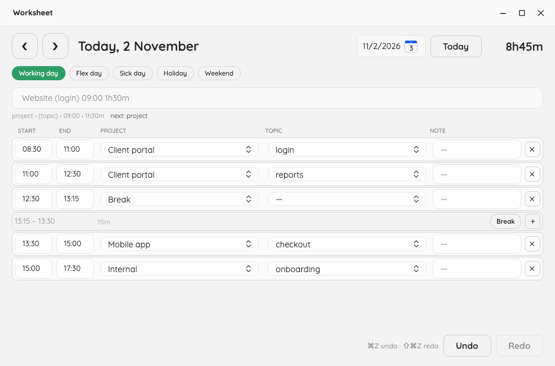
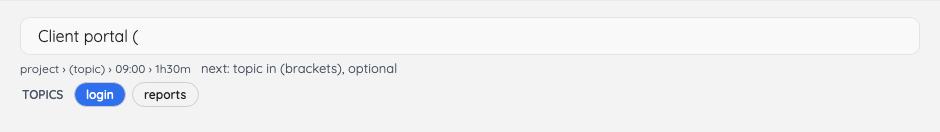
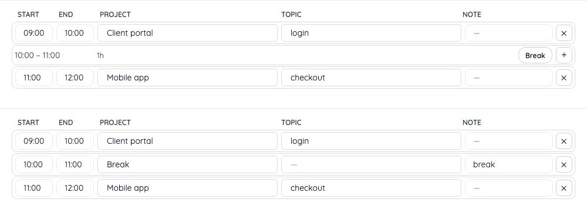
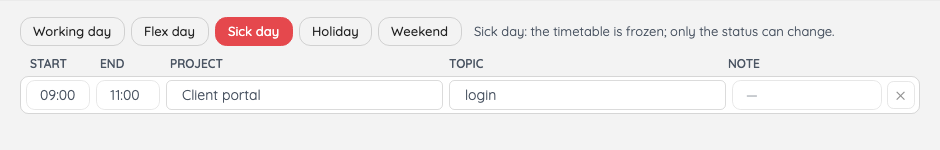
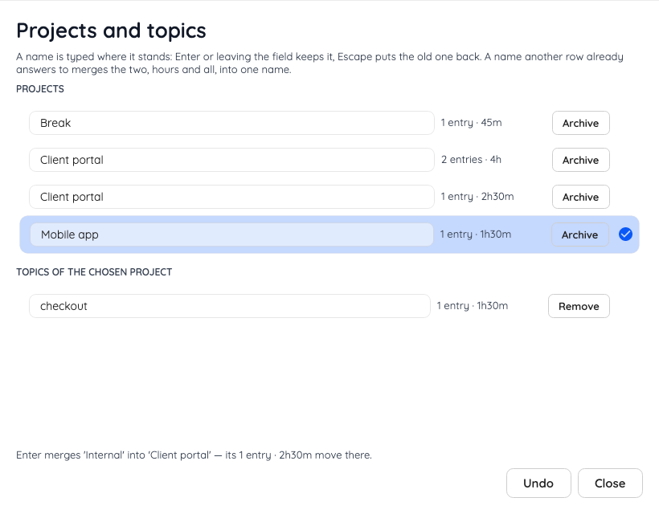

# Worksheet

Log your working day in one line, on projects and on the topics inside them.



## Install

macOS and Linux:

```sh
curl -fsSL https://raw.githubusercontent.com/d-led/worksheet.net/main/install.sh | bash
```

Windows:

```powershell
irm https://raw.githubusercontent.com/d-led/worksheet.net/main/install.ps1 | iex
```

Each installs one self-contained binary. They fetch the newest build of `main`, so there is no
release to wait for. How those builds are made: `docs/development.md`.

Or take the file yourself. These links always give the newest build:

| Platform | Download |
|---|---|
| macOS arm64 | [worksheet-osx-arm64](https://nightly.link/d-led/worksheet.net/workflows/build/main/worksheet-osx-arm64.zip) |
| macOS x64 | [worksheet-osx-x64](https://nightly.link/d-led/worksheet.net/workflows/build/main/worksheet-osx-x64.zip) |
| Linux x64 | [worksheet-linux-x64](https://nightly.link/d-led/worksheet.net/workflows/build/main/worksheet-linux-x64.zip) |
| Linux arm64 | [worksheet-linux-arm64](https://nightly.link/d-led/worksheet.net/workflows/build/main/worksheet-linux-arm64.zip) |
| Windows x64 | [worksheet-win-x64](https://nightly.link/d-led/worksheet.net/workflows/build/main/worksheet-win-x64.zip) |

Unzip and run it: `chmod +x worksheet-*` on macOS and Linux, a double-click on Windows. macOS refuses
a downloaded binary until the quarantine flag is off; the installer clears it, and
`xattr -d com.apple.quarantine worksheet-osx-arm64` does the same by hand.

## Log a day

One line records one time range. Type it, press Enter.

| you type | what it records |
|---|---|
| `Client portal (login) 08:30 2h30m` | a project, a topic, a start and a length |
| `Client portal (reports) 11:00-12:30` | a range instead of a length |
| `Break 12:30 45m` | no topic |
| `Reading 14:00 2h 30m # the paper` | spaced units and a note |
| `3.11. Reading 14:00 45m` | another day than the one on screen |

A project name may contain spaces. Names you have used before are offered as you type: the projects
first, then the topics of that project once its bracket is open.



`←` `→` (or `↑` `↓`) walk the offers, `Tab` takes the one they are on, and the next bracket is
written for you: `(` after a project, `)` after a topic. A line that cannot be recorded is refused
in one sentence beside it.

## Fix a day

The table shows absolute times — when a block started and when it ended — one row per block, in
start order. Every cell is editable: the times, the project, the topic, the note. A correction is a
change, so undo takes it back.

The project and topic cells take a name you type, not only one from the list. A name nobody has used
yet is created when you leave the cell, so a block can be moved onto a new project without returning
to the entry line.

The holes between blocks are rows of their own, with their length. `＋` puts that range into the
entry line; `Break` records it directly as a `Break` entry with a note you can change:



Under the line, a `next:` hint names the part still missing, and an error — an intersection with
another block, for instance — is shown while you type.

## Move between days

`←` and `→` walk a day back and forward, as long as the caret is not in one of the fields. `❮` `❯`,
`Today` and the calendar do the same with the mouse.

## Export a range

*Export month* in the heading writes one zip for the month the day on screen belongs to; the arrow
beside it offers the day, the quarter and the year. The file is named for when it was taken and what
it covers — `2026-11-04-0930-worksheet-2026-11.zip` — and holds two files:

- `worksheet-2026-11.json` — the range as data: minutes per project and per project and topic, and
  every logged day with its entries. The first field, `version`, is the format version: it changes
  only when a reader of the older file would read the newer one wrongly, so a script can check it
  and stop.
- `worksheet-2026-11.html` — totals with shares, a bar per project and a bar per project and topic, a
  lane per project and topic over the days of the range, and a foldable list of the days. A heading
  sorts its table, by name or by time, whichever way it is pressed twice. Bootstrap comes from a CDN;
  without a connection the page still reads, unstyled.

Days that hold nothing are left out; the page says so at the bottom.

## Days that do not work

Above the table sits the day's status: `Working day`, `Flex day`, `Sick day`, `Holiday`, `Weekend`.
Saturday and Sunday start as weekend; any of the five can be chosen.



A day that is not a working day is frozen: what is recorded stays on screen, and nothing on the day
can be changed — no new line, no correction, no retraction, no break from a hole. Choose `Working
day` to edit it again. A status is a change, so undo takes it back.

## Undo and redo

`⌘Z` / `⇧⌘Z`, `Ctrl+Z` / `Ctrl+Shift+Z`, or the two buttons at the bottom. Anything recorded after an
undo discards the redo history; how undo is stored is in `docs/adr/0001-event-sourced-ledger.md`.

## Let an agent log for you

While the application is running it answers MCP on `http://127.0.0.1:5317/mcp`, on the loopback
only. *Connect an agent…* in the tray menu shows the two snippets a client needs — VS Code reads
`servers` in `.vscode/mcp.json`, most other clients read `mcpServers`:

```json
{
  "servers": {
    "worksheet": {
      "type": "http",
      "url": "http://127.0.0.1:5317/mcp"
    }
  }
}
```

An agent can log a line, read a day back, ask for totals per project, list the catalogue, rename or
remove a project or a topic, and undo. Answers are sentences, refusals included. Each change it makes
is one step in the window's undo. The port comes from *Settings…* or `WORKSHEET_MCP_PORT`; `0` turns
the server off.

## Rename or retire a project

*Projects and topics…* in the heading's `⋯` (or in the tray menu) lists every project in use with
what each holds, and the topics of the one you choose. A name is edited where it stands: `Enter` or
leaving the field keeps the new name, `Esc` puts the old one back.



A name another row already answers to is not refused — it merges the two. The line above the message
says so while the name is still being typed, with what would move; `Enter` then makes it one name,
with the entries of both, in one change. So one undo takes a merge back as readily as a rename.

Retiring a project or a topic leaves every entry exactly as it was, under the name it was logged
with — the history is not rewritten — and simply stops offering that name; typing it again brings
the project back with its topics.

Moving a few hours from one project or topic to another, without renaming anything, is a separate
decision and is not offered yet.

## The tray

Closing the window hides it; the day keeps counting. A click on the tray icon raises the window. The
menu — a right click on Windows and Linux, the icon itself on macOS — holds *Show window*, *Connect
an agent…*, *Projects and topics…*, *Settings…*, *Open data folder* and *Quit*. A second copy exits
at start-up.

The window offers the same four screens without the tray: the *⋯* at the right of the heading opens
*Settings…*, *Projects and topics…*, *Connect an agent…* and *Open data folder*. Only *Quit* lives in
the tray alone, because it is not a screen.

## Where your data lives

One file:

- macOS — `~/Library/Application Support/Worksheet`
- Windows — `%APPDATA%\Worksheet`
- Linux — `~/.config/Worksheet`

Set `WORKSHEET_DATA_DIR` to keep it elsewhere.

Beside the journal sit its weekly copies — `ledger-2026-W44.db` and three more. One is written when
a week closes, the application checks once an hour and at start-up, and the fifth week deletes the
oldest. Putting one back under the name `ledger.db` is the whole of a restore.

Beside the journal sits `settings.json`, with the two values *Settings…* writes: the MCP port and how
often the fold is rewritten. A stored value wins over the environment, the environment over the
built-in value; *Revert to defaults* removes the stored choice, so `WORKSHEET_MCP_PORT` and
`WORKSHEET_SNAPSHOT_EVERY` decide again.

## Licence

Mozilla Public License 2.0, see [LICENSE](LICENSE).
